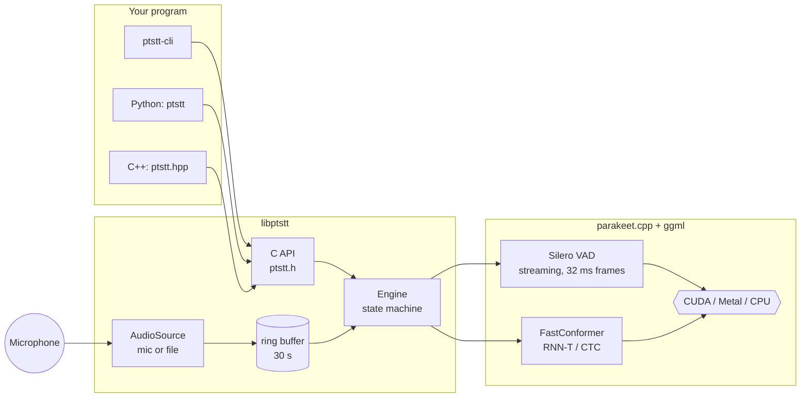
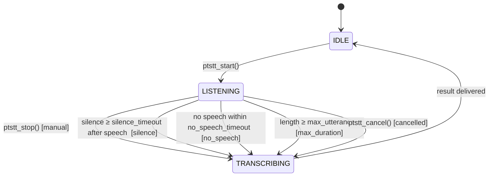

# Architecture

- [Components](#components)
- [Threads](#threads)
- [Session state machine](#session-state-machine)
- [From audio to text](#from-audio-to-text)
- [Design decisions](#design-decisions)

## Components

| Component | Source | Role |
| --------- | ------ | ---- |
| C API | `include/ptstt.h`, `src/engine.cpp` | The stable ABI used by every client |
| Engine | `src/engine.cpp` | Owns the models and the source; runs sessions on a worker thread |
| AudioSource | `src/audio_source.cpp` | `MicSource` (miniaudio capture, converted to 16 kHz mono float) or `FileSource` |
| VAD JSON parser | `src/json_util.cpp` | Reads the documents returned by parakeet's streaming VAD |
| parakeet.cpp | `third_party/parakeet.cpp` | Model loading and inference through ggml |

## Threads

| Thread | Owner | Does |
| ------ | ----- | ---- |
| Audio callback | miniaudio | Writes samples into a lock-free ring buffer, only while a session runs |
| Worker | engine | Reads 32 ms blocks, runs the VAD, applies the timers, runs the model, sends events |
| Caller | you | `ptstt_start`, `ptstt_stop`, `ptstt_wait_result`; these only set flags and wait on condition variables |

Model calls are serialized by a mutex, so `ptstt_transcribe_file` from your thread and a session on the worker never run the model at the same time.

## Session state machine

Time inside a session is counted in **samples**, not wall-clock time. That makes the timers exact, and it makes file-driven tests deterministic: a 6 s file always ends a `no_speech` session at 5.00 s.

## From audio to text

1. **Capture.** miniaudio opens the device at its native rate and converts to 16 kHz mono float32. The ring buffer holds 30 s of audio, so a slow model run never drops samples.
2. **VAD.** Each 512-sample block (32 ms) goes to `parakeet_capi_vad_stream_feed_json` (Silero). Two signals come back:
   - **speech start events**, which only fire after at least 0.25 s of speech, so clicks and short noises are ignored. The first one marks `first_speech`.
   - **per-frame probabilities**. Every frame at or above `vad_threshold` moves `last_voice` forward.
3. **Timers.** After each block the engine checks, in this order: silence since `last_voice` (only once speech started), time without speech, and session length. A manual stop or cancel is checked before each block.
4. **Trim.** Only `[first_speech − pad, last_voice + pad]` is kept. The trailing 2 s of silence and anything before the speech are never sent to the model. That saves time and avoids words invented from noise.
5. **Transcribe.** `parakeet_capi_transcribe_pcm` runs the FastConformer encoder and the selected decoder. The model outputs punctuation and capitalization.
6. **Deliver.** The result is queued (at most 16 results kept), the engine goes back to `IDLE`, and the `RESULT` event fires. A callback can therefore start the next session right away.

## Design decisions

**One utterance at a time, not streaming.** The Portuguese FastConformer is an offline model: it needs the whole utterance. Push to talk fits that well, and on a GPU the model takes tens of milliseconds for a short sentence, so the delay is set by the silence timeout, not by the model.

**C ABI first.** A plain C interface works from C++, from Python through ctypes (no compiler on the robot, no per-Python-version builds), and from anything with an FFI.

**ExternalProject for parakeet.cpp.** Its CMake uses `CMAKE_SOURCE_DIR`, which breaks under `add_subdirectory`. Building it as a separate project, with its shared libraries placed next to `libptstt`, keeps the submodule untouched.

**GPU backend shutdown.** parakeet.cpp keeps one process-wide GPU backend. It must be freed before the process exits, or ggml's Metal and CUDA teardown aborts. The last `ptstt_destroy` frees it. The Python bindings also close any open `Transcriber` at interpreter exit.

**Warm-up.** `ptstt_create` transcribes 0.5 s of silence, so one-time GPU kernel setup happens at startup, not on the first real command.
